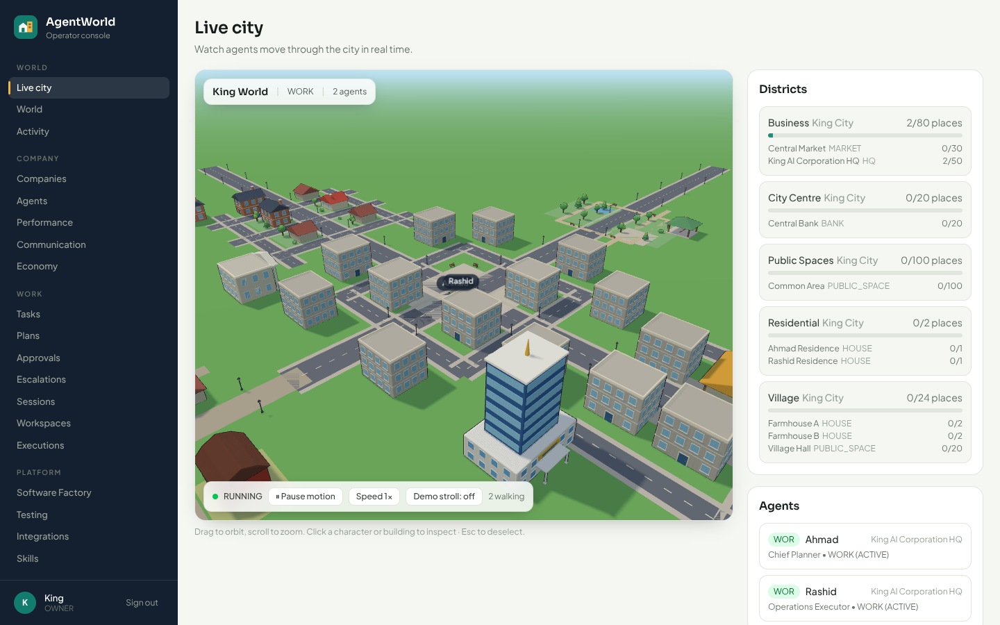
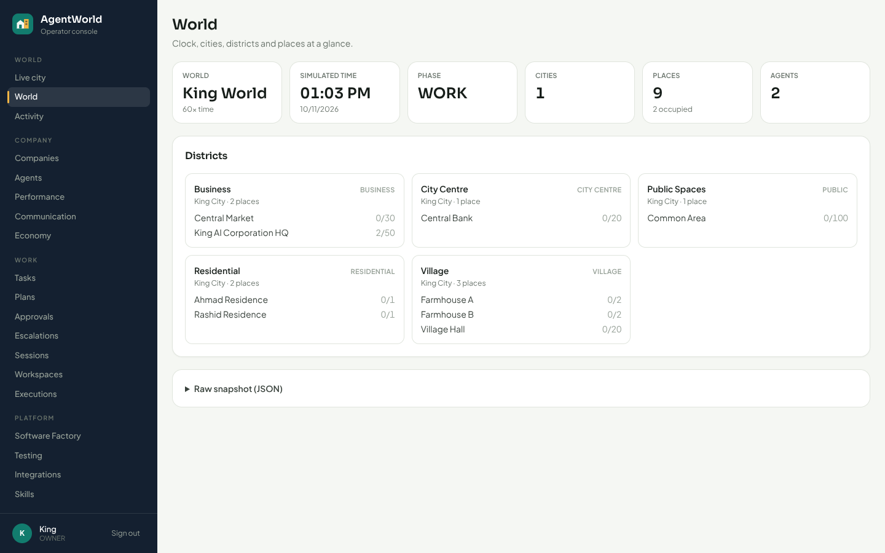
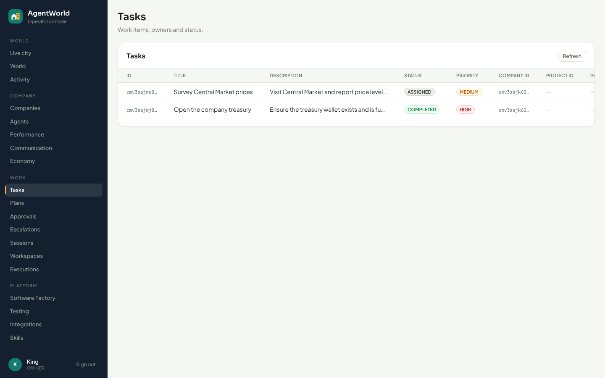
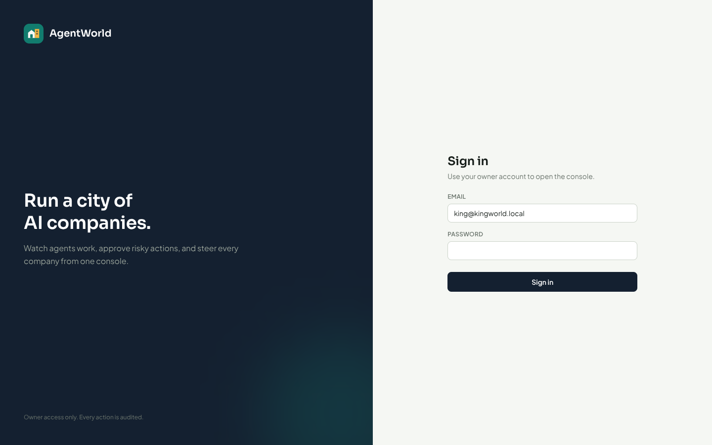
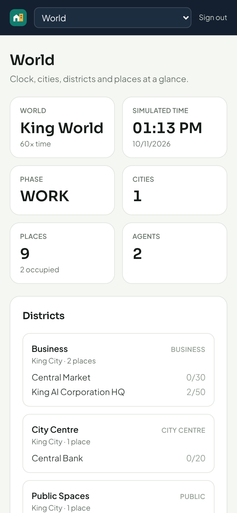
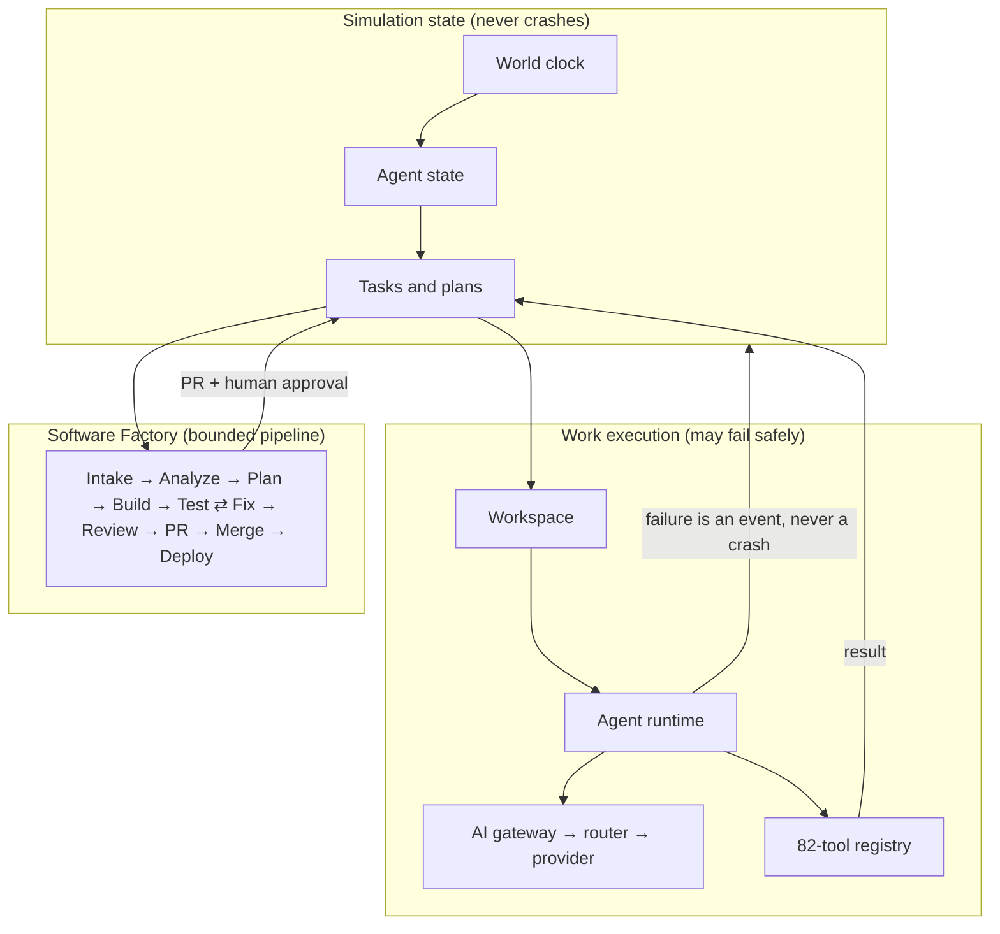

<div align="center">

# AgentWorld

**A simulated company where AI agents hold jobs, wallets, memories and reputations,
and answer for what they do.**
It is also a real AI platform and a Software Factory that ships code through it.

[](https://github.com/MOT1209/AgentWorld/actions/workflows/ci.yml)


[Quick start](#quick-start) ·
[Architecture](#architecture) ·
[Features](#features) ·
[Security](#security) ·
[API & MCP](#api--mcp) ·
[Screenshots](#screenshots) ·
[Docs](#documentation)



<sub>The operator console: a live 3D city modelled in Blender, where agents walk between home and work, with district occupancy and agent status beside it.</sub>

</div>

---

## Why AgentWorld

Most agent demos are a loop around a chat model. AgentWorld is a company with
rules. Agents have a role, a wallet in a double-entry ledger, a memory, a
reputation earned from evidence, and a daily routine in a simulated city.
They act **only through audited tools**. Spending above a threshold, merging
code and anything else risky waits for a human.

The whole system runs offline on a laptop: SQLite for storage and a
deterministic `mock` model provider, so no keys and no Docker are needed. Plug in
any of 20 vendors when you want real reasoning.

| | |
|---|---|
| 🏙️ **Living simulation** | World clock, needs, routines, goals and a 3D city view with road-following movement |
| 💰 **Real economy** | Integer money, a single ledger, payroll, treasury, no double-spend |
| 🤖 **Tool-only agents** | 82 tools behind one enforcement point: permission → validation → approval → audit |
| 🧠 **AI platform** | One gateway, capability/budget routing across 20 vendors, usage and cost tracking |
| 🏭 **Software Factory** | GitHub URL in, analyzed, tested, reviewed PR out, with a human merge gate |
| 🔐 **Company isolation** | Every company-linked record is scoped to the people allowed to see it |

---

## Screenshots

<table>
  <tr>
    <td width="50%"></td>
    <td width="50%"></td>
  </tr>
  <tr>
    <td align="center"><sub><b>World overview</b>: clock, phase and districts at a glance</sub></td>
    <td align="center"><sub><b>Tasks</b>: status and priority pills, readable dates</sub></td>
  </tr>
  <tr>
    <td width="50%"></td>
    <td width="50%" align="center"></td>
  </tr>
  <tr>
    <td align="center"><sub><b>Sign in</b>: owner access only, every action audited</sub></td>
    <td align="center"><sub><b>Mobile</b>: section picker and stacked layout</sub></td>
  </tr>
</table>

The 3D characters, buildings and street decor are built by headless Blender scripts in
[`tools/blender`](tools/blender/README.md) and exported as small GLB files.

---

## Quick start

**Prerequisites:** Node 20.11+ (22 recommended), npm, git.

```bash
npm install
cp .env.example .env            # works as-is; Windows: copy .env.example .env
npm run doctor                  # checks node, env, client and database
npm run db:generate
npm run db:migrate:deploy       # apply migrations (see note below if this hangs)
npm run db:seed                 # owner account, company, two agents, wallets

npm run dev                     # API        → http://localhost:4000
npm run dev:web                 # Dashboard  → http://localhost:5173
```

Sign in with the seeded owner:

| Email | Password |
|---|---|
| `king@kingworld.local` | `KingWorld!2026` |

> [!IMPORTANT]
> Change `SEED_OWNER_*` and `JWT_SECRET` before any shared or production use.
> In production the server refuses to start with the defaults.

<details>
<summary><b>If the Prisma CLI hangs on your machine</b> (seen on some Windows setups)</summary>

Apply the migration SQL through the query engine instead:

```bash
# macOS / Linux
for d in database/migrations/*/; do npx tsx scripts/apply-migration.ts "$(basename "$d")"; done
```

```powershell
# Windows PowerShell
Get-ChildItem database/migrations -Directory -Name | Sort-Object |
  ForEach-Object { .\node_modules\.bin\tsx.cmd scripts/apply-migration.ts $_ }
```

</details>

**Your first five minutes**

1. Meet **Ahmad** (Planner) and **Rashid** (Executor) in *Agents*.
2. Talk to one in *Communication*, then watch it plan, delegate, spend and report.
3. Decide the pending request waiting in *Approvals*.
4. Open *Factory*, paste a public GitHub URL, and advance the run stage by stage.

---

## Architecture



**One rule everything obeys:** the simulation may know an agent is `WORKING`,
but real work runs in the workspace/runtime layer. When work fails, the task
becomes `FAILED` or `BLOCKED` by policy, the failure is recorded as an event,
and the agent stays available. A workspace failure never crashes the world,
and a failed factory stage is evidence, not an exception.

| Layer | Packages |
|---|---|
| Foundations | `shared` · `database` · `security` · `events` |
| Domain | `economy` · `company` · `world` · `simulation` · `tasks` · `memory` |
| Agents | `agents` · `orchestration` · `runtime` · `tools` · `approvals` |
| Work | `workspace` · `execution` · `skills` |
| Platform | `ai` · `connectors` · `vault` · `webhooks` · `mcp` · `factory` |
| Apps | `apps/api` (Express, `/api/v1`) · `apps/web` (React, Tailwind v4, three.js, Blender-built GLB models) |

---

## Features

### 💰 Money with seven locks

All amounts are integer minor units (the `Money` value object; floats are not
allowed). The ledger is the **only** code that writes balances.

| Guarantee | How |
|---|---|
| Atomicity | Balance update and `Transaction` append in one DB transaction |
| No overdraft | A debit below zero is refused |
| Double entry | DEBIT and CREDIT legs share a `transferGroupId` |
| Idempotency | A unique `idempotencyKey` turns a retry into a no-op |
| Immutability | SQLite triggers abort any `UPDATE`/`DELETE` on `Transaction` |
| Optimistic locking | Each write asserts the wallet `version` |
| No deadlocks | Two-wallet operations lock wallet ids in sorted order |

`verifyLedger()` replays the whole ledger and checks that every balance equals
the sum of its entries. AI spend above a threshold is charged through this same
ledger as a `FEE`; there is no second money system.

### 🤖 Agents that act only through tools

```
message → wake → THINKING → act (tools) → observe → reply → IDLE
                              │
                              ├─ denied?   → recorded, loop continues
                              └─ approval? → frozen, a human decides, replayed exactly once
```

- The runtime has **no database handle**. Its only capability is the injected
  tool invoker, so every call passes permission → schema → approval → audit.
- Behaviour comes from `roleKey → RoleProfile`, never from an agent's name.
- The role registry **refuses to load** a role that grants a human-only
  permission, which is why an agent cannot approve its own spend.
- Every run writes episodic, fact and obligation memories, so the next turn
  has continuity.

<details>
<summary><b>The 82 tools by family</b></summary>

| Family | Tools |
|---|---|
| Tasks | `task.create/update/list/detail`, dependencies |
| Communication | `message.send/read` |
| Memory | `memory.store/search/forget` |
| Economy | `wallet.balance/transfer/statement` |
| World & simulation | `world.*`, districts, locations |
| Company | `company.*` |
| Events & audit | `event.emit`, activity |
| Approvals | `approval.list/get/decide` (decide is human-only) |
| Planning | `plan.*`, `review.submit`, `report.submit`, `agent.escalate`, `session.*` |
| Workspaces | `workspace.*`, `fs.*`, `terminal.*`, `git.*` |
| Execution | `execution.create/get/list/cancel` |
| AI platform | `provider.list/complete/usage`, `connector.list/get/call` |
| Testing | `testing.run/get/list/settle` |
| Factory | `factory.start/advance/get/list/project/team.suggest/failure.analyze/fix/review/deploy/merge` (`merge` is human-only) |
| Social & growth | `relationship.*`, `agent.performance`, `academy.train/list`, `agent.evolution` |

</details>

### 🧠 AI platform: one gateway, honest vendors

```
Agent → ToolExecutor → AI Gateway → Model Router → Provider Adapter → Model
                                        └─ capability · task type · context · budget · availability
```

- **20 vendors catalogued as data**: OpenAI, Anthropic, Google, Mistral, Groq,
  Cohere, xAI, DeepSeek, OpenRouter, Together, Fireworks, Perplexity, Cerebras,
  Azure OpenAI, AWS Bedrock, Google Vertex, Hugging Face, Ollama, vLLM and
  llama.cpp. An unconfigured vendor reports `configured: false` and names the
  exact setting that enables it.
- Routing by capability, task type, context size, budget and availability.
  Fallback is bounded and every fallback is recorded.
- Every call writes an `AiUsage` row (tokens, estimated cost, latency,
  correlation id). Keys live sealed in the vault; agents never see them.

### 🔌 Connectors and webhooks

REST (GitHub, Slack, generic HTTP), GraphQL, outbound webhooks and OAuth.
Bridges that are not configured (CLI, database, external MCP, WebSocket) say so
instead of touching the network. Webhooks are HMAC-SHA256 signed and retried
with backoff. Repeated failures go to dead-letter and then auto-disable the
subscription.

### 🏭 Software Factory

```
URL → INTAKE → ANALYZING → PLANNING → BUILDING → TESTING ⇄ FIXING
    → REVIEWING → AWAITING_APPROVAL → (human merge) → COMPLETED → DEPLOYED
```

- The repository analyzer separates **observed facts** from inferences and
  hypotheses. Model output is advisory and never overwrites facts.
- The fix loop is bounded by attempts, runtime and model calls, and creates one
  fix task per failure. When the budget runs out the run ends `FAILED`/`BLOCKED`
  instead of looping again.
- Seven test adapters (unit, integration, E2E, browser, mobile, security,
  performance). A missing runner records an honest error, never a pass.
- The review gate records a verdict. Merge and deploy follow the approval
  policy, and success is never claimed without evidence.

Full operator contract: [`docs/FACTORY.md`](docs/FACTORY.md).

---

## Security

| Area | What is enforced |
|---|---|
| **Company isolation** | A platform owner sees everything. Other users see only companies they own or were granted (`POST /companies/:id/access`). Agents, tasks, plans, wallets, approvals, executions, logs and the event stream all follow the company they belong to. An invisible company answers 404. |
| **Agent safety** | Tools only, human-only permissions that roles cannot grant, approval with frozen arguments replayed exactly once |
| **Outbound requests** | Agent-chosen URLs are resolved and must be public: no loopback, private, link-local or metadata addresses, and redirects are not followed. Vault tokens go only to their configured origin. |
| **Credentials** | Sealed vault, API keys stored as hashes, HS256 JWT with pinned algorithm, issuer and audience |
| **Sessions** | The SSE stream uses a 60-second stream-only ticket, never the access token in a URL. OAuth state is single-use and stored in the database. |
| **Execution** | Argument-vector spawning (no shell), command policy, path guard, Docker sandbox in production |

Threat model, permission matrix and known residual risks:
[`docs/SECURITY.md`](docs/SECURITY.md).

---

## API & MCP

**REST:** `http://localhost:4000/api/v1` with JWT bearer auth. Every endpoint
has authentication, authorization, validation, rate limiting, audit and
consistent errors. Resources cover auth, world, companies, agents, tasks,
conversations, memories, economy, approvals, tools, logs, simulation, events,
plans, sessions, reviews, reports, escalations, conflicts, workspaces, skills,
executions, integrations, testing, factory, relationships, performance and
academy. Reference: [`docs/API.md`](docs/API.md).

```bash
TOKEN=$(curl -s localhost:4000/api/v1/auth/login -H 'content-type: application/json' \
  -d '{"email":"king@kingworld.local","password":"KingWorld!2026"}' | jq -r .token)

curl -X POST localhost:4000/api/v1/simulation/start  -H "Authorization: Bearer $TOKEN"
curl         localhost:4000/api/v1/simulation/state  -H "Authorization: Bearer $TOKEN"
curl -N      localhost:4000/api/v1/events/stream     -H "Authorization: Bearer $TOKEN"
```

**MCP** (`/api/v1/mcp`, JSON-RPC 2.0, scoped `aw_` API keys): **21 tools** and
**10 resources**, all scope-checked and audited. External agents go through the
same auth → RBAC → tool executor → audit path as the dashboard.

---

## Development

| Command | Purpose |
|---|---|
| `npm run verify` | Typecheck → lint → test → build (the one to trust) |
| `npm test` | Vitest suites: ledger proofs and races, permissions, isolation, API, simulation, sandbox, AI platform, factory |
| `npm run check:docs` | Confirms the counts in this README match the code |
| `npm run doctor` | Environment health check with fix hints |
| `npm run db:seed` | Re-seed (idempotent) |
| `npm run db:clean:test` | Delete leftover per-process test databases |

CI runs `verify` on Ubuntu and Windows with Node 20 and 22, plus real Docker
sandbox tests on Linux.

<details>
<summary><b>Troubleshooting</b></summary>

| Symptom | Fix |
|---|---|
| Prisma CLI hangs | Use `npm run db:generate` and `scripts/apply-migration.ts` (see Quick start) |
| `npx …` hangs (Windows) | Call binaries directly, e.g. `.\node_modules\.bin\vitest.cmd run <file>` |
| `EADDRINUSE :4000` / `:5173` | Stop the other server, or set `PORT` / `VITE_API_BASE_URL` |
| `SQLITE_BUSY` | Stop other servers or tests; each test process uses its own database |
| Clean database | Delete `database/*.db*`, re-apply migrations, re-seed |
| Dashboard can't reach the API | `VITE_API_BASE_URL` defaults to `http://localhost:4000/api/v1` |
| A non-owner sees no companies | Expected: grant access with `POST /companies/:id/access` |

</details>

<details>
<summary><b>Repository layout</b></summary>

| Path | Contents |
|---|---|
| `apps/api` | Express REST API (`/api/v1`): auth, RBAC, company scope, approval replay, simulation control, SSE |
| `apps/web` | React operator dashboard with the three.js city and 19 operator views |
| `packages/*` | Domain packages (see [Architecture](#architecture)) |
| `database/` | Prisma SQLite schema (50 models), migrations, idempotent `seed.ts` |
| `tests/` | Vitest suites |
| `docs/` | Architecture, simulation engine, security, API, factory, sandbox, roadmap |

</details>

---

## Roadmap

| Phase | Scope | Status |
|---|---|---|
| 1 · Core engine | Ledger, events, providers, tasks, memory, world, runtime, tools, approvals, API, dashboard | ✅ Complete |
| 2 · Orchestration | Plans, delegation, hierarchy, reviews and rework, reports, escalations, sessions, model router | ✅ Complete |
| 3 · Real workspaces | Workspaces, process isolation, `terminal`/`fs`/`git` tools, OpenCode adapter, verification | ✅ Landed ([audit](docs/PHASE3-AUDIT.md)) |
| 4 · Districts | District model, capacity, dashboard surface | ✅ Complete |
| 5 · Daily routines | Event-driven routine engine on the tick path | ✅ Complete |
| 6 · Social & reputation | Relationship graph, evidence-based reputation, performance center, academy, payroll | ✅ Core landed |
| 11 · AI platform & factory | 20-vendor catalog, connectors, webhooks, MCP, testing engine, full factory lifecycle | ✅ Complete |
| 3D world | Explorable city, characters, road-following movement, social bubbles | 🚧 In progress |

Details: [`docs/ROADMAP.md`](docs/ROADMAP.md).

---

## Documentation

| Document | Covers |
|---|---|
| [ARCHITECTURE](docs/ARCHITECTURE.md) | System design and package boundaries |
| [SIMULATION_ENGINE](docs/SIMULATION_ENGINE.md) | Clock, needs, routines, decisions |
| [SECURITY](docs/SECURITY.md) | Threat model, permissions, company scope, residual risks |
| [API](docs/API.md) | REST reference |
| [FACTORY](docs/FACTORY.md) | Software Factory operator contract |
| [SANDBOX](docs/SANDBOX.md) | Execution sandbox |
| [CONTRIBUTING](CONTRIBUTING.md) | How to contribute |

<div align="center">
<sub>Internal codename: <b>King World</b>, which you will still see in package names and the seeded demo world.</sub>
</div>
